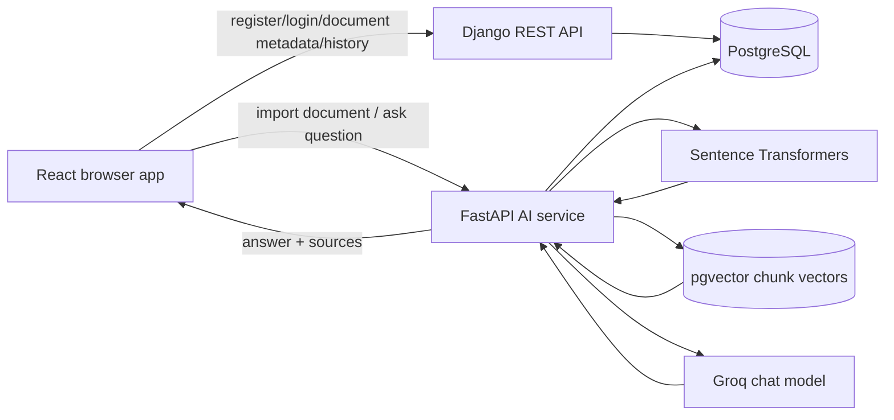

# Architecture

## System overview

The application uses a three-process local development architecture:

1. **React frontend** — user interface and browser-side state.
2. **Django REST Framework** — user accounts, JWT endpoints, document metadata, chat history, and exports.
3. **FastAPI AI service** — document parsing, chunking, embedding generation, vector retrieval, and Groq answer generation.

Both backend services are configured to use PostgreSQL. The AI service uses pgvector for vector similarity search.

## High-level diagram

## Responsibilities and boundaries

| Component | Owns |
|---|---|
| React frontend | Forms, dashboard, auth state, API calls, answer/source display |
| Django | User-facing application APIs, user-owned document records, chat-history persistence, export |
| FastAPI | Text extraction, chunking, local embeddings, vector search, LLM request |
| PostgreSQL | Relational application data and AI chunk storage |
| pgvector | Vector column and similarity operations |
| Sentence Transformers | Local embedding generation |
| Groq | External LLM inference |

## Main request flows

### Authentication

1. The user submits credentials in the frontend.
2. The frontend calls Django's registration or SimpleJWT token endpoint.
3. Django returns JWT tokens.
4. The frontend stores and attaches the access token according to its Axios/auth-state implementation.

### Document ingestion

1. The frontend uploads a document to Django.
2. Django saves a `Document` record owned by the authenticated user.
3. The frontend receives the document record ID.
4. The frontend sends the file and document ID to FastAPI's `/documents/import` endpoint.
5. FastAPI extracts text, chunks it, creates embeddings, and writes chunk records.
6. The frontend refreshes the document list.

The source currently performs this as a sequence of HTTP requests, not as a durable background task queue.

### Question answering

1. The frontend sends a question, selected document IDs, answer mode, and source limit to FastAPI `/ask`.
2. FastAPI embeds the question.
3. FastAPI retrieves relevant vector chunks from PostgreSQL/pgvector.
4. FastAPI builds context and calls the configured Groq model.
5. FastAPI returns an answer and source objects.
6. The frontend displays the result and sends chat history to Django.

### Deletion

Django exposes document deletion and calls FastAPI to delete associated vector chunks. Review failure handling and consistency behavior before production use: a failed cross-service delete can leave orphaned vector data.

## Design trade-offs

- **Separate AI service:** isolates model loading and retrieval logic from account and CRUD APIs, but introduces service-to-service coordination.
- **Local embeddings:** avoids a hosted embedding API dependency, but model loading consumes local memory and CPU.
- **PostgreSQL + pgvector:** keeps relational records and vector data in the PostgreSQL ecosystem, but requires extension/schema setup.
- **Synchronous ingestion:** simpler to understand and develop, but long-running imports can make requests slow and fragile.
