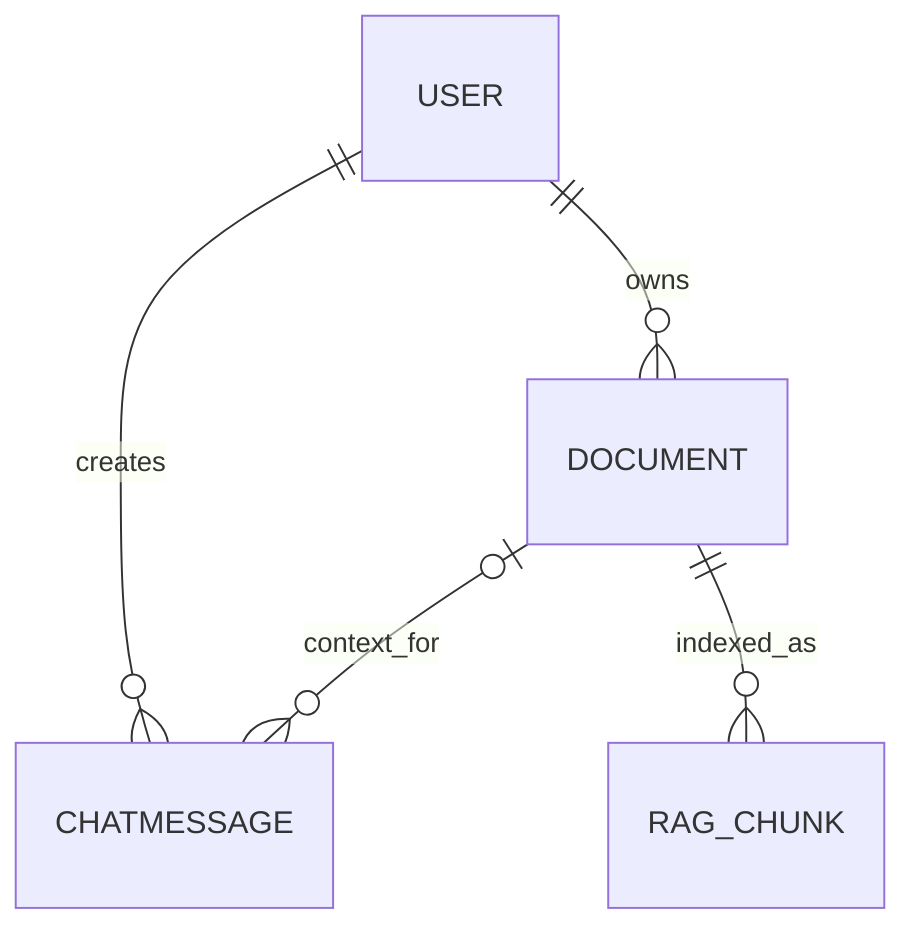

# Database Schema

This document summarizes the schema visible in the current Django models and FastAPI vector-storage code. Confirm actual deployed table names and SQL migrations against the target database.

## Django `Document`

The Django `Document` model contains:

| Field | Purpose |
|---|---|
| `owner` | Foreign key to the authenticated user |
| `title` | User-visible document title |
| `file` | Uploaded file field |
| `file_type` | Stored file type label |
| `status` | `uploaded`, `processing`, `indexed`, or `failed` |
| `chunk_count` | Number of chunks reported after indexing |
| `file_size` | File size metadata |
| `summary` | Summary field returned/stored by ingestion workflow |
| `error_message` | Indexing error information |
| `last_indexed_at` | Last successful indexing timestamp |
| `created_at` | Record creation timestamp |

## Django `ChatMessage`

| Field | Purpose |
|---|---|
| `owner` | Foreign key to authenticated user |
| `document` | Optional foreign key to a document; set null if deleted |
| `question` | User's question |
| `answer` | Generated answer |
| `mode` | `document`, `hybrid`, or `general` |
| `confidence` | Text field; do not interpret as calibrated probability |
| `sources_json` | JSON list of returned source data |
| `created_at` | Record creation timestamp |

## AI chunk table

The FastAPI service uses a `rag_chunks` table with vector data. The source code refers to fields including:

| Field | Purpose |
|---|---|
| `id` | Chunk row identifier |
| `document_id` | Related Django document ID |
| `source_title` | Document title for source display |
| `chunk_index` | Position of chunk in the document |
| `page_number` | Source page number when available |
| `chunk_text` | Extracted chunk text |
| `embedding` | pgvector vector (384 dimensions) |
| `created_at` | Chunk creation time |

The vector table is linked by document ID in application logic; it is not represented as a Django foreign key in the shown model definitions.

## Relationship overview

## Important operational notes

- Django and FastAPI must point to the same PostgreSQL database if the application is expected to share document IDs and chunk data.
- Enable pgvector in the target PostgreSQL database before running vector operations.
- Back up relational records and vector chunks together.
- Confirm the actual `rag_chunks` DDL, indexes, and vector operator classes in the database; this document is not a database migration.
